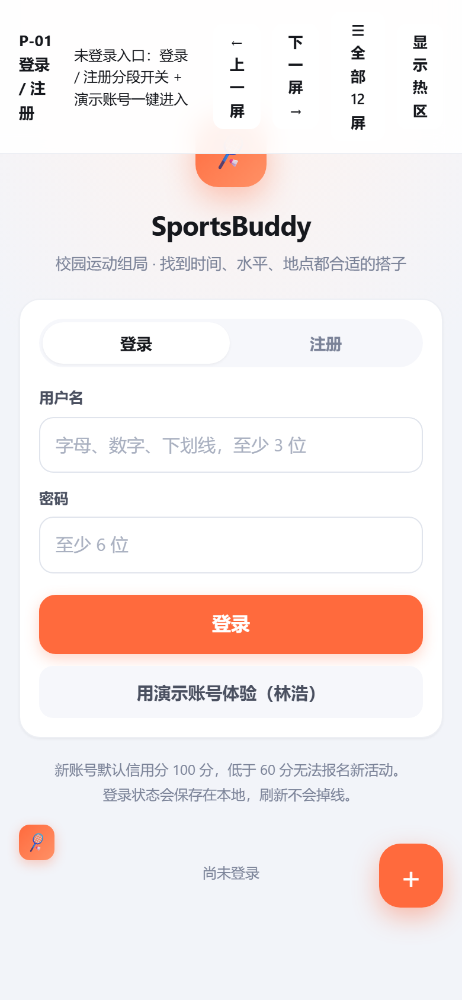
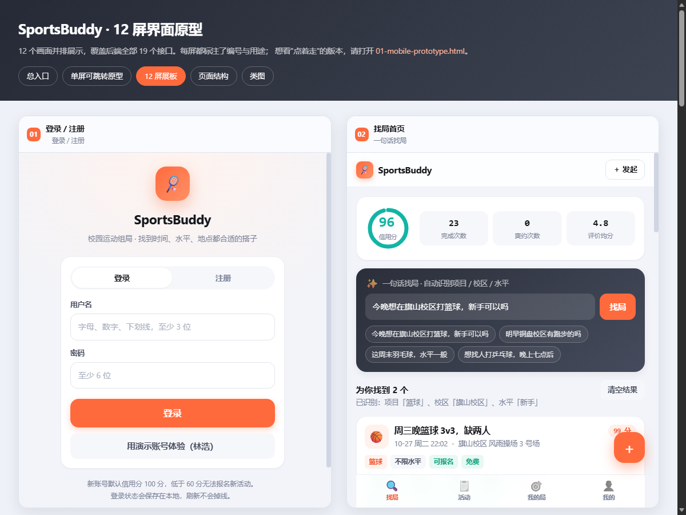
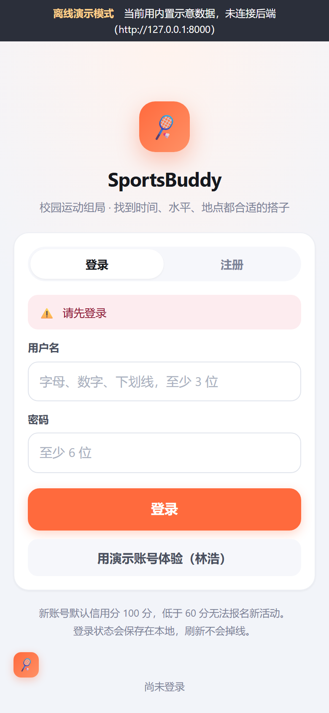
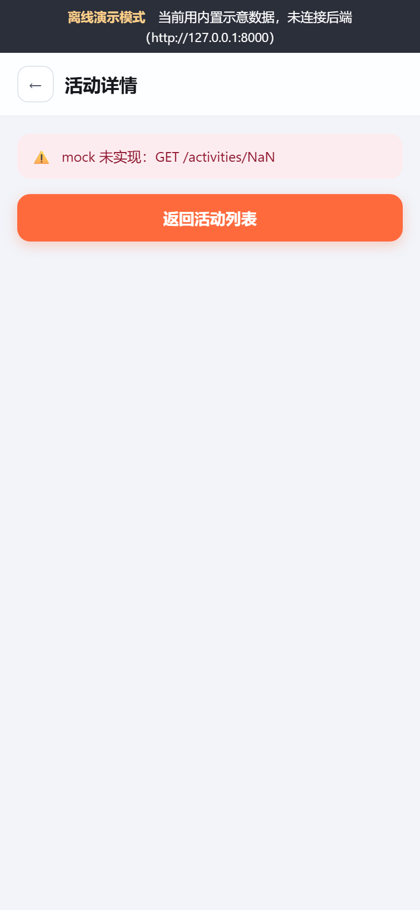

# SportsBuddy 作业四（原型设计）差距分析与软件测试报告

EE308FZ 软件工程 · 第 12 组 Falcons

| 项目 | 内容 |
| --- | --- |
| 仓库 | https://github.com/Falcons-FZU-MU-SE-GROUP12/SportsBuddy |
| 检出提交 | `26ae61c`（`--depth 1` 浅克隆） |
| 作业要求 | https://bbs.csdn.net/topics/620556488 |
| 截止时间 | 2026-11-01 23:59（报告生成于 2026-10-31） |
| 测试对象 | `assignment4/prototype` 原型；`src/sportmate-app` 前端应用 |
| 测试环境 | Windows · Microsoft Edge headless + Chrome DevTools Protocol |

> **本报告结论摘要**
>
> 1. `assignment4` 目前只有一份「界面原型」的 HTML 源码，博客、PPT、团队照片、分工贡献表、线上原型链接全部缺失。
> 2. 原型未发布：GitHub Pages 两个候选地址均返回 404，无法满足「提供可访问链接 + 答辩现场演示」的硬性要求。
> 3. 原型本身存在 4 个浏览器端缺陷，其中 12 屏同时渲染、长页面无法滚动属于阻断性问题，不能直接用于答辩。
> 4. 真实前端应用存在 2 个阻断性 bug：登录不保存 token、带参数路由丢失参数。

## 一、本次操作与读取范围

按要求在当前工作目录执行了克隆并逐个读取 `assignment4` 下的全部文件。原有目录是一个 `.git` 不完整的损坏浅克隆（缺少 refs、残留 `shallow.lock`），直接 clone 报 `destination path already exists`；删除后重新浅克隆成功。

- 克隆命令：`git clone --depth 1 https://github.com/Falcons-FZU-MU-SE-GROUP12/SportsBuddy.git`
- 检出提交：`26ae61c  Add work log entries for assignments 3 and 4`
- 逐个读取 `assignment4` 下 9 个文件（4 个 HTML、1 个 CSS、README、调研报告、3 个 `.gitkeep` 占位文件），并访问了作业要求页面提取评分点。

### 读取文件清单

| 文件 | 大小 / 行数 | 作用与判断 |
| --- | --- | --- |
| `assignment4/README.md` | 1,616 B | 目录约定与评分摘要；写明工具为 MoDao（墨刀） |
| `assignment4/prototype/prototype/mobile-prototype.html` | 134,197 B / 3,738 行 | 单文件 12 屏移动端原型（CSS/JS 全内联） |
| `assignment4/prototype/prototype/screens.html` | 19,975 B | 12 屏展板，依赖 `../frontend` 模块，需 HTTP 服务 |
| `assignment4/prototype/prototype/index.html` | 9,890 B | 交付总览与导航，依赖 `../frontend`、`../docs` |
| `assignment4/prototype/prototype/wireframe.html` | 21,409 B | 页面结构与跳转信息架构图（内联 SVG） |
| `assignment4/prototype/prototype/css/gallery.css` | 7,009 B | 展板专用样式（`smp-` 前缀） |
| `assignment4/evidence/Sportsmate-Research Report…md` | 3,407 B | 匹配算法与大模型 API 调研（非作业四要求的证据） |
| `assignment4/blog/.gitkeep` | 0 B | 博客目录为空 |
| `assignment4/slides/.gitkeep` | 0 B | PPT 目录为空 |

## 二、按 CSDN 评分点核对：还缺什么

作业总分 100 分，分为基础要求 20 分、原型设计 30 分、成果报告 30 分、答辩 20 分。逐项核对结果如下。

| 分值 | 评分要求 | 当前状态 | 结论 |
| --- | --- | --- | --- |
| 5' | 目录 + 格式说明表（课程/作业/团队名/目标/参考资料）+ 原型网页链接 | 无博客 | 缺 |
| 5' | 博客使用 Markdown 格式 | 无博客 | 缺 |
| 4' | 关键点与挑战分析 | 无博客 | 缺 |
| 6' | 学号/工作/贡献比例分工表；团队组织、角色、进度与协作方式 | 无博客 | 缺 |
| 5' | 必须使用专门原型工具（Axure/墨刀等）并在博客写明 | README 写墨刀，但实际交付为手写 HTML/JS | 高风险 |
| 25' | 原型设计过程与结果（贴合需求、体验好、易操作、设计美观） | 有 HTML 原型，但见第三节缺陷 | 部分完成 |
| 15' | 原型介绍：文字准确、风格清晰、设计理念 | 无博客 | 缺 |
| 15' | 难点描述 5' + 解决尝试与是否解决 5' + 收获 5' | 无 | 缺 |
| 8' | 完成过程 + 非摆拍团队讨论照片 + 感想与互评 | 无照片 | 缺 |
| 4' | 计划执行情况、分工与工作量比例 | 无 | 缺 |
| 4' | PPT / PDF 设计报告 | `slides/` 为空 | 缺 |
| 4' | PPT 内含可访问原型链接；现场打开链接演示点击与跳转 | 无线上链接（GitHub Pages 404） | 缺 |
| — | 原型发布为网页并提供链接 | 仅本地文件 | 缺 |
| — | 每次上传在 `WORKLOG.md` 登记一行 | 无博客/PPT 记录 | 缺 |

### 必须优先补齐的四件事

- **博客正文**：TOC、格式说明、分工贡献表、工具说明、设计过程、原型介绍、难点/尝试/收获、团队照片。放在 `assignment4/blog/` 并发布到 CSDN。
- **PPT/PDF**：放在 `assignment4/slides/`，且封面或演示页必须写入可点击的原型 URL。
- **线上原型链接**：启用 GitHub Pages 或把自包含原型上传 Netlify/Vercel/墨刀，拿到可访问地址后同步到博客与 PPT。
- **非摆拍团队讨论照片**：放入 `assignment4/evidence/` 并插进博客；现有 evidence 只有算法调研报告，不能替代。

> **关于「专门原型工具」的风险提示**
>
> 作业明确要求：原型模型必须使用 Axure RP、墨刀、Balsamiq Mockup 等专门原型设计工具实现，并在博客中说明所用工具。
>
> 当前交付物是可运行的 HTML/CSS/JS，属于「前端实现」而非「原型工具产出」。README 虽写了 MoDao，但仓库内没有 `.modao`/`.rp` 工程或墨刀分享链接。
>
> 建议：用墨刀按现有 12 屏重建（或导入截图做可点击热区），取得 `modao.cc` 分享链接，把该链接同时写进博客与 PPT。否则这 5 分存在被判为「未使用专门工具」的风险。

## 三、原型测试结果（assignment4/prototype）

测试方法：用无头 Edge 通过 DevTools Protocol 打开页面，设置真实设备尺寸（390×844、1200×900），逐屏切换、点击真实控件，并采集布局尺寸、可见性与控制台错误。

### 3.1 阻断性问题

| 编号 | 问题 | 实测证据 | 影响 |
| --- | --- | --- | --- |
| P0-1 | 12 屏同时渲染，屏幕切换无效 | HTML 使用 `class="screen"`（`mobile-prototype.html:1390`），CSS 只写了 `.proto-screen`（:1215）。实测 12 个 section 全为 `display:block`，内容总高 15,556px，被 390×844、`overflow:hidden` 的 `.proto-stage` 裁切。 | P-02/P-03/P-10 等长页面无法滚动查看；`is-active` 不生效；`#p08` 只是滚动被隐藏的容器。 |
| P0-2 | 手机端顶栏不隐藏，遮挡内容 | 隐藏规则在 `@media(max-width:560px)`（:1202/:1210），而基础样式 `.proto-chrome{display:flex}` 写在其后的 :1228，同优先级被覆盖。390px 宽实测顶栏高 129.9px。 | 手机上首屏被顶栏压住，影响观感与操作。 |
| P0-3 | P-02 悬浮「＋」按钮浮在所有屏上 | `.sm-fab` 为 `position:fixed`，且 12 个 section 全部保留在文档流中。实测 P-01 激活时仍可见来自 p02 的 `.sm-fab`（top≈712）。 | 登录页等非列表页出现不属于它的按钮，演示时容易误导。 |
| P1-4 | P-12 星级评分不可用 | 初始渲染 10 颗星（2 人×5）全部 `aria-checked="true"`；点击写入的是 `aria-pressed`，而样式只认 `[aria-checked]`。实测点击 3 星后选中数仍为 10/10。 | 评价页最核心的交互无法演示。 |

### 3.2 交付目录依赖缺失

`assignment4/prototype/prototype` 下的 `index.html`、`screens.html`、`wireframe.html` 都引用 `../frontend/…` 与 `../docs/…`，但 `assignment4/prototype` 下并没有这两个目录（它们位于 `src/sportmate-app/`）。实测结果：

| 页面 | 在 `assignment4` 下 | 在 `src/sportmate-app` 下 |
| --- | --- | --- |
| `index.html` / `wireframe.html` | `app.css` 404，页面样式失效；类图链接 404 | 正常 |
| `screens.html` | 12 个手机框停在骨架屏，启动失败 | 12 帧就绪，日志显示「已就绪」，仅 favicon 404 |
| `mobile-prototype.html` | 可打开，但存在 3.1 的 P0 问题 | 同一文件，问题相同 |

另外，项目自带的 `node tools/verify.mjs` 仍显示「全部通过：99 项检查」。该自检只覆盖纯函数、接口与静态结构，不加载浏览器布局，因此上述渲染缺陷全部漏检。

### 3.3 可复用的现成素材

- **12 屏 JPG**：`src/sportmate-app/out/prototype-jpg/` 下有 P-01～P-12 共 12 张，另有总览图。
- **类图 JPG**：`src/sportmate-app/out/class-diagram-jpg/` 下有普通版与适合插入文档版。
- **自包含展板**：`src/sportmate-app/share/SportsBuddy-prototype/02-screens-gallery.html` 可直接双击打开，适合作为博客配图或临时演示。
- **建议**：把 share 包中的自包含版本复制进 `assignment4/prototype`，替换当前依赖缺失的源码版，确保评阅人双击即可查看。

## 四、前端应用测试结果（src/sportmate-app/frontend）

通过本地静态服务（`node tools/server.mjs 5199`）以 390×844 打开真实前端，执行「演示账号登录 → 活动列表 → 打开活动 → 我的」流程。

### 4.1 阻断性缺陷

| 编号 | 问题 | 原因与证据 | 影响 |
| --- | --- | --- | --- |
| A-1 | 登录/注册后仍是未登录状态 | 全仓库不存在 `tokenStore.set`：`api/index.js:30` 的 login 只返回 token，未写入 localStorage。实测 login 返回 `mock-token-1` 后，立即调用 `getMe` 得到 401「请先登录」。 | 「用演示账号体验」直接失败；刷新掉线，与页面文案相反；所有需登录页面无法进入。 |
| A-2 | 带参数路由丢失参数 | `main.js:22/25/27` 注册页面时写作 `async () => create()`，未把 router 传入的 `route.params` 交给 create。实测访问 `#/activity/101` 后页面报「mock 未实现：GET /activities/NaN」。 | 活动详情、签到、管理、评价、个人主页、编辑活动均不可用。 |

### 4.2 正常的部分

- 找局首页、活动列表、4 个底部标签页、离线 mock 的 6 条活动数据均可正常渲染。
- `screens.html` 展板在 `src/sportmate-app` 下可正常启动，12 个手机框均渲染完成。
- 浏览器控制台仅有 `favicon.ico` 的 404，无脚本报错。
- **后端未测试**：本机 Python 3.8 / 3.14 均未安装 pytest、fastapi，未擅自安装依赖。

## 五、建议处理顺序

| 优先级 | 事项 | 预计工作量 | 负责建议 |
| --- | --- | --- | --- |
| P0 | 修复原型 P0-1/P0-2/P0-3/P1-4（screen 类名、顶栏层级、悬浮按钮、星级状态） | 0.5～1 小时 | 前端负责人 |
| P0 | 把自包含原型发布为网页（GitHub Pages/Netlify），取得可访问 URL | 0.5 小时 | 队长 |
| P0 | 补 `assignment4/blog` 博客并发布到 CSDN（含目录、格式说明、分工表、工具、过程、难点、照片、链接） | 4～6 小时 | 全员分工 |
| P0 | 制作 PPT/PDF 放入 `slides/`，封面写原型 URL | 2～3 小时 | 汇报人 |
| P0 | 补非摆拍团队讨论照片到 `evidence/` 并插入博客 | 0.5 小时 | 全员 |
| P1 | 用墨刀重建 12 屏并取分享链接，满足「专门工具」要求 | 2～4 小时 | 产品/设计 |
| P1 | 修前端 A-1（token 落盘）与 A-2（参数透传），以便答辩演示真实应用 | 1 小时 | 前端负责人 |
| P1 | 按规范在 `WORKLOG.md` 登记本次所有上传 | 10 分钟 | 队长 |

> **时间提醒**
>
> 作业截止时间为 2026-11-01 23:59；博客需要预留审核时间，建议今天完成发布。
>
> 截止后两天内提交按实际得分 ×50% 计；超过两天视为缺交，记 0 分。

## 附录：测试环境与关键路径

| 项目 | 值 |
| --- | --- |
| 仓库根目录 | `C:\Users\30260\SportsBuddy` |
| 原型目录 | `assignment4\prototype\prototype` |
| 前端应用目录 | `src\sportmate-app\frontend` |
| 静态服务器 | `node tools/server.mjs 5199`（工作目录 `src/sportmate-app`） |
| 浏览器 | `C:\Program Files (x86)\Microsoft\Edge\Application\msedge.exe` |
| 测试方式 | headless=new + CDP：`Emulation.setDeviceMetricsOverride` / `Runtime.evaluate` / `Page.captureScreenshot` |
| 自检脚本 | `node tools/verify.mjs` → 99 项全部通过（未覆盖浏览器渲染） |

报告结束。
