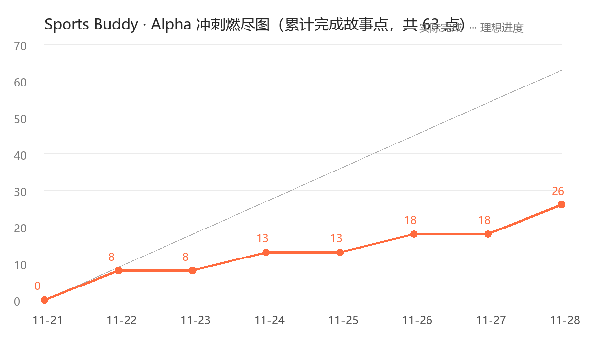

# 第五次作业 · Alpha 冲刺总结（Falcons · Group 12）

| 项目 | 内容 |
|---|---|
| 本次作业属于哪门课程 | EE308FZ Software Engineering（福州大学—梅努斯 FZU-MU） |
| 本次作业的要求在哪里 | [第五次作业——Alpha Sprint（CSDN 社区公告）](https://bbs.csdn.net/topics/620611106) |
| 本次作业的目标 | 完成一次 8 天 Alpha 冲刺：代码规范与计划 → 4 篇冲刺日志 → 1 篇测试博客 → 1 篇冲刺总结，交付可运行版本 |
| 团队仓库 | [Falcons-FZU-MU-SE-GROUP12/SportsBuddy](https://github.com/Falcons-FZU-MU-SE-GROUP12/SportsBuddy) |
| 冲刺时间 | 2026-11-21 ~ 11-28（每两天一篇冲刺日志，共 4 篇） |
| 其他参考 | 《构建之法》、阿里巴巴 Java 开发手册 v1.3.0、华为内部代码规范、FastAPI / SQLAlchemy 文档 |

---

## 一、预期计划 vs 实际进展

### 1.1 冲刺任务完成情况（S1–S16，共 63 点）

| 任务 | Issue | 点数 | 状态 | 说明 |
|---|---|---|---|---|
| S1 认证：登录/注册 + token 持久化 | #4 | 5 | 🔄 | 后端实现完成、验收测试 2 条全过，待关闭 |
| S2 个人主页 | #5 | 3 | ✅ | 接真实后端 + 13 项断言 + 3 张截图（11-22 关闭） |
| S3 发起活动 API + 表单 | #6 | 5 | 🔄 | 后端验收测试全过；前端表单 mock 版已有，真实后端联调收尾中 |
| S4 活动列表 + 筛选 | #7 | 5 | ✅ | 分页/筛选/竞态防护 + 28 项断言 + 7 张截图（11-24 合入） |
| S5 活动详情 | #8 | 3 | 🔄 | 前端完成（17 项断言 + 5 张截图），待合并关闭 |
| S6 报名 / 取消报名 | #9 | 5 | ✅ | 信用分规则对齐 + 21 项断言 + 5 张截图（11-26 关闭） |
| S7 数据持久化 + 种子数据 | #10 | 3 | 🔄 | 验收测试通过，随演示环境就绪 |
| S8 签到（4 位码 / 定位） | #11 | 5 | 🔄 | 后端验收测试 4 条全过；前端页面 mock 版已有 |
| S9 活动管理（考勤） | #12 | 3 | 🔄 | 后端验收测试 3 条全过；前端页面 mock 版已有 |
| S10 我的局 | #13 | 3 | 🔄 | 后端验收测试 3 条全过；前端页面 mock 版已有 |
| S11 活动评价 | #14 | 5 | 🔄 | 后端验收测试 3 条全过；前端页面 mock 版已有 |
| S12 信用分规则 | #15 | 5 | ✅ | 规则矩阵 12 条用例全过（11-22 关闭） |
| S13 站内提醒（简版） | #16 | 3 | 🔄 | 后端待收尾 |
| S14 自动化 E2E + 测试报告 | #17 | 5 | 🔄 | 后端 54 项 pytest 全过 + Alpha 测试报告；UI 级 E2E 待前端补 `data-testid` |
| S15 Bug 修复缓冲 | #18 | 3 | ✅ | 并发报名超员（DEF-01）已修复并有探针复现 |
| S16 演示环境 / 部署 | #19 | 2 | ✅ | 幂等种子脚本 + README 一键演示说明 |

**已关闭 7 个 Issue、共 26 点；其余 9 个 Issue 的后端验收测试全部通过，处于「前端联调收尾 / 待合并关闭」阶段。**

### 1.2 燃尽图

> 口径：按 Issue 实际关闭日期累计完成故事点；11-28 的 26 点含 #8（代码与证据就绪、待合并关闭）。
> 理想线按 63 点 / 8 天匀速。真实曲线前慢后快：前三天集中在打地基（认证、信用分、演示数据），
> 后段前端三项（列表→报名→详情）集中收口。

### 1.3 可运行证据

- **在线代码**：仓库 `src/frontend`（零依赖，`node tools/server.mjs` 即起）、`src/backend`（FastAPI + SQLite，首次启动自动建表）
- **前端自检**：`node tools/verify.mjs` —— **178 项全部通过**（19 接口覆盖 / 业务规则 / 11 页渲染 / 时区 / 匹配解析 / #5·#7·#8·#9 验收）
- **后端测试**：`py -m pytest -q` —— **54 passed**
- **真实后端运行截图**（`docs/shots/`，全部 `?mock=0`）：
  - 个人主页 3 张（`issue5-*`）、活动列表 7 张（`issue7-*`）、报名取消 5 张（`issue9-*`）、活动详情 5 张（`issue8-*`）
  - Alpha 测试证据图 `alpha-test-evidence-2026-11-24.png`

---

## 二、成员收获、团队协作与工作量分配

### 2.1 分工与贡献（Alpha 阶段）

| 组 | 成员 | 主要贡献（据仓库提交与 WORKLOG） |
|---|---|---|
| 项目管理 | 黄志远（队长） | 16 个冲刺 Issue 创建与验收口径、博客汇总、集成与提交 |
| 产品需求 | 张子乐、叶一凡 | 验收标准与需求对齐、冲刺日志 1 |
| 前端开发 | 林子均 | #5 个人主页接真实后端（PR #22，`linzj`）；#6/#8 页面基础 |
| 前端开发 | 李昊泽 | #7 活动列表（PR #23）、#9 报名/取消、#8 活动详情的前端实现与验收 |
| 前端开发 | 李震浩 | #7/#9 联调协作与数据准备（按冲刺计划表分工） |
| 前端开发 | 何景浩 | 通用组件与 #11–#14 页面 mock 版基础 |
| 后端开发 | 张景天、余成浩、张新宇、许博宇 | 19 个接口实现；#8/#9/#11–#14 各验收测试；DEF-01 并发修复；演示环境种子脚本 |
| 算法 | 蔡耀华 | #15 信用分规则实现 |
| 测试 | 王少杰 | #15 规则矩阵 12 用例、并发探针、Alpha 测试报告（54 项全过） |

> 具体到人的细节以队长的工作量汇总为准；各组个人感悟建议各补一两句（模板见 2.2）。

### 2.2 前端组的收获与感悟（本组详写）

- **契约必须可执行地"锁住"，而不是口头对齐**：这次最典型的是信用分——后端 PR #20 把规则改成
  「初始 80 / 临期 -2 / 爽约 -10」后，前端常量还是旧值（100 / 5 / 15），**后端实扣 2 分、界面提示扣 5 分**。
  教训是：跨组规则不只靠沟通，还要把常量断言写进 `verify.mjs`（H0 段），谁先漂移谁当场红。
- **mock 与真实后端会有隐蔽差异**：mock 的 `participants` 不含 `cancelled` 记录，真实后端含——
  结果参与者计数对不上（#8 DEF-01）。以后每个页面至少跑一次 `?mock=0` 的真实数据再算验收。
- **自动化截图脚本是答辩的底气**：CDP 无头 Edge + `--eval` 先点筛选再截，让"满员 409 / 信用分不足 /
  临期取消弹窗"这些难以复现的状态都有图可证，比口头描述强得多。
- **时区是联调头号隐形杀手**：naive UTC 存储 + 带 `Z` 参数做字符串比较，"今天"筛选整天查不出（#7 DEF-02）。
  全部时间换算收敛到 `format.js` 单一出口后，这类问题一次解决、处处受益。

### 2.3 团队协作

- 提交与日志证据链完整：每个 commit 关联 Issue，WORKLOG 逐行登记；
- 前后端以「验收测试先行」协作：后端每完成一个 Issue 就交一份 `test_issueXX_*.py`，前端照着验收测试联调；
- 缺陷单（DEF-01/02/03）以「现象—根因—建议修法」形式跨组流转，并发报名超员在 11-26 由后端修复并留了复现探针。

---

## 三、下一阶段展望

1. **收尾未合并项**：#8 合并关闭、#6 表单接真实后端、#11–#14 四页照 #7/#8/#9 的流程补齐证据；
2. **UI 级 E2E**：前端统一补 `data-testid`，测试组按「筛选 → 详情 → 报名 → 签到 → 评价」跑通全链路（#17）；
3. **公网可用**：Render 免费实例预热与多人并发复测（SQLite→Postgres 行为差异已在报告里留了坑位）；
4. **Beta 冲刺**：匹配推荐（作业四调研的双塔召回 + LLM 重排）落地到首页"一句话找局"、评价与信用分闭环打磨、
   答辩 PPT 与燃尽图数据持续同步。

---

## 附：本作业的博客链接汇总

| 编号 | 内容 | 链接 |
|---|---|---|
| (1) | 博文汇总置顶帖 | （队长维护，此处贴链接） |
| (2) | 代码规范、冲刺任务与计划 | （发布后贴 CSDN 链接） |
| (3) | 冲刺日志 ×4（11-22 / 11-24 / 11-26 / 11-28） | （各篇发布后贴链接） |
| (4) | 测试博客 | （测试组发布后贴链接） |
| (5) | 冲刺总结（本文） | （发布后贴 CSDN 链接） |

*本总结的数字来源：GitHub Issue 状态与关闭时间、WORKLOG、`node tools/verify.mjs`（178 项）与
`pytest -q`（54 项）实测输出；截图见 `docs/shots/`。*
